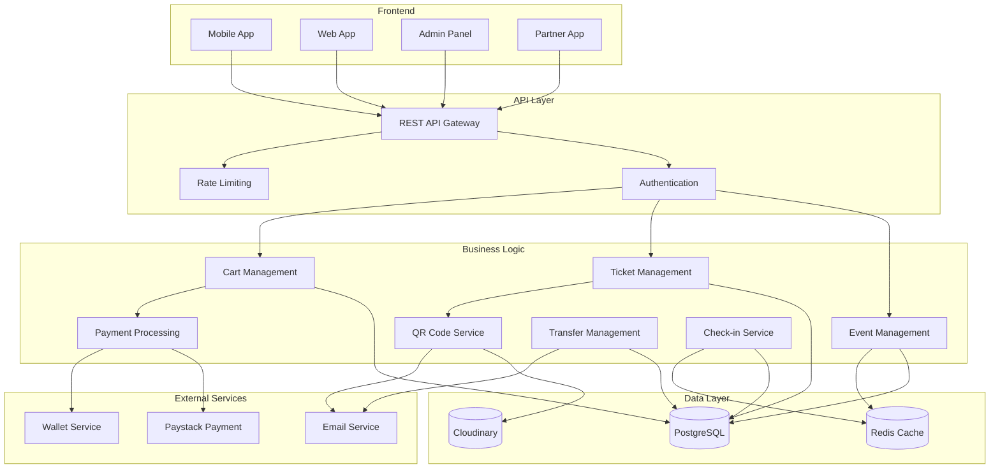
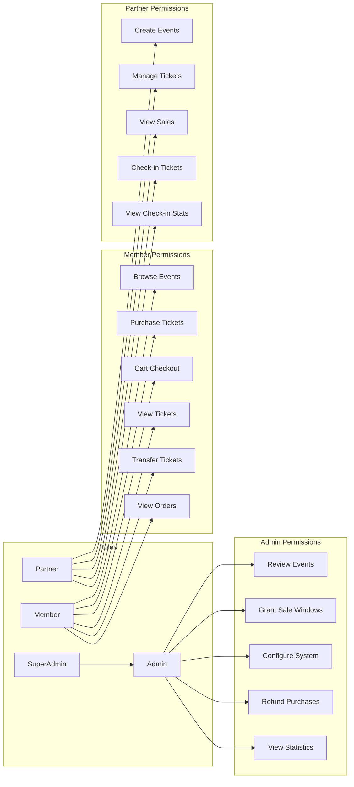
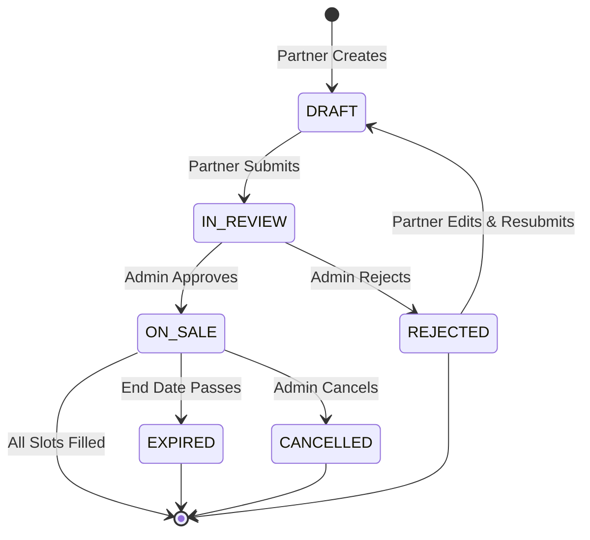
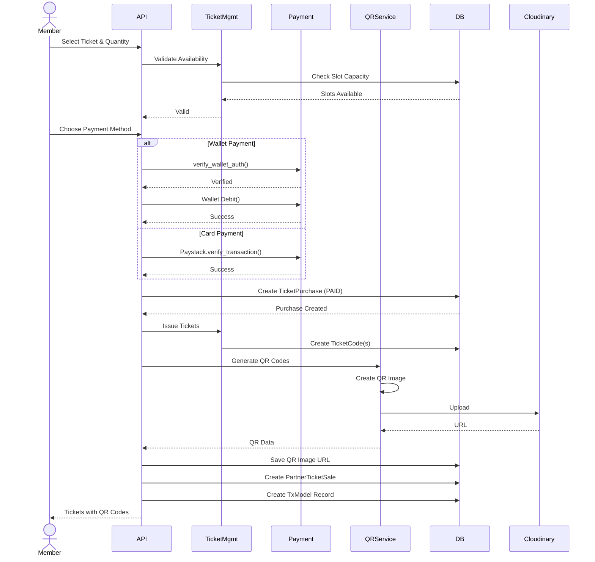
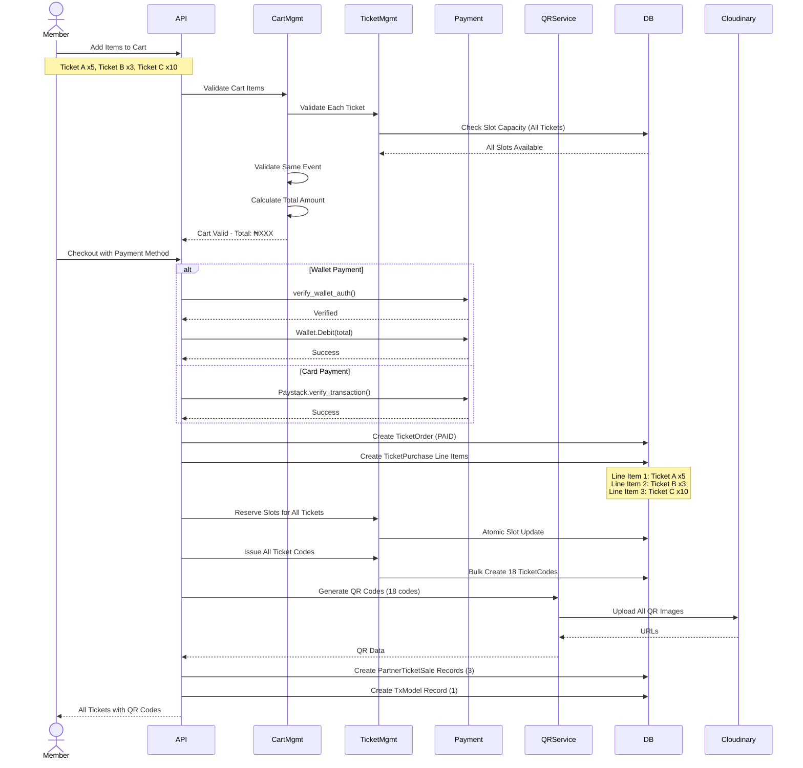
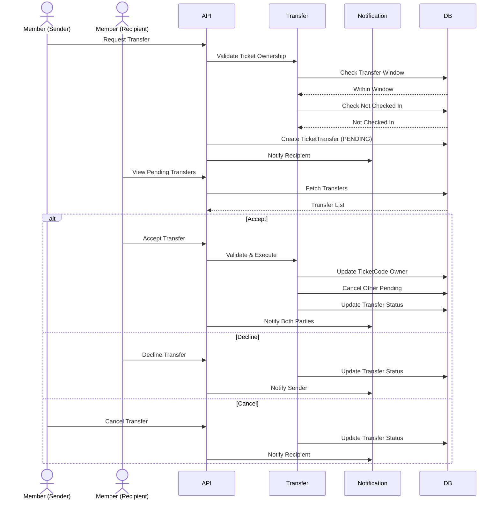
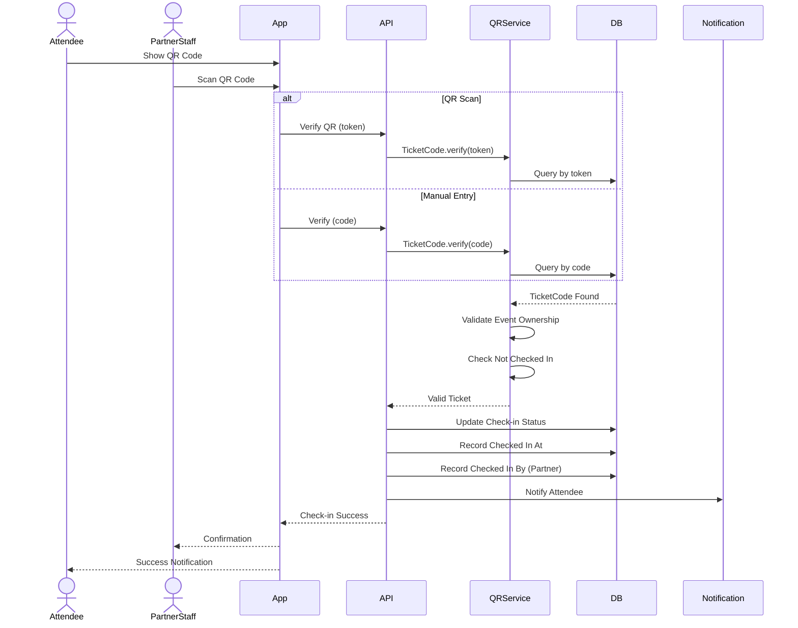
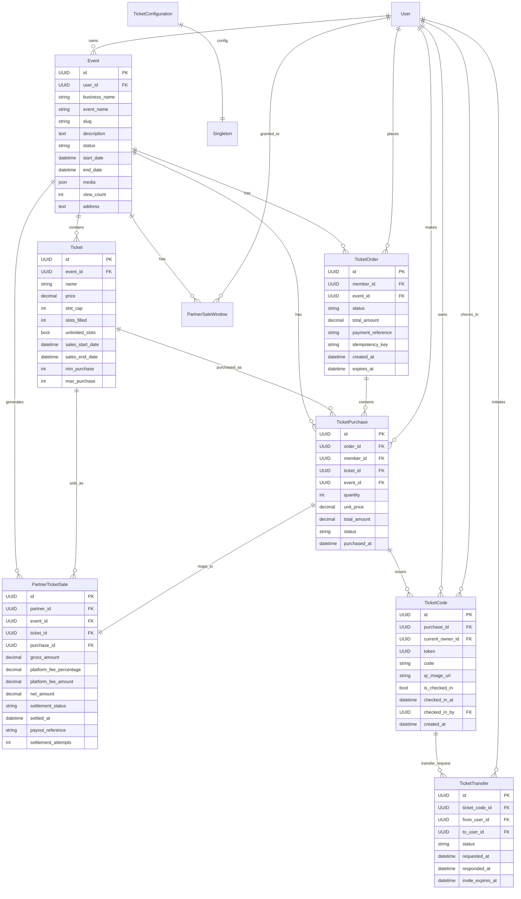

# Event/Ticketing Feature Documentation

## Overview

The Event/Ticketing system is a comprehensive solution for creating, managing, and selling event tickets. It supports a complete lifecycle from event creation to attendee check-in, with features including QR code generation, ticket transfers, cart-based purchasing, and payment processing.

## Table of Contents

- [High-Level Architecture](#high-level-architecture)
- [System Components](#system-components)
- [User Roles](#user-roles)
- [Core Features](#core-features)
- [Data Models](#data-models)

---

## High-Level Architecture

---

## System Components

### 1. Event Management

- Create and manage events
- Event approval workflow (Draft → In Review → On Sale)
- Event categorization and tagging
- View count tracking

### 2. Ticket Management

- Multiple ticket types per event
- Configurable pricing and capacity
- Unlimited slots option
- Sales start/end dates
- Slot capacity management
- Minimum/maximum purchase limits per ticket type

### 3. Cart Management

- **Multi-ticket checkout**: Purchase multiple ticket types in a single transaction
- **Same-event validation**: All cart items must belong to the same event
- **Atomic order processing**: All line items processed in a single database transaction
- **Combined payment**: Single payment for all cart items
- **Order history**: Track all past orders with their line items
- **Idempotency support**: Prevent duplicate orders with idempotency keys

### 4. QR Code System

- QR code generation using `qrcode` library
- Cloudinary upload for QR images
- Token-based verification
- Human-readable fallback codes
- Follows StoreVisitQRCode pattern

### 5. Payment Processing

- **Wallet Payment**: Debits from user's 9PSB wallet
- **Card Payment**: Paystack transaction verification

### 6. Ticket Transfers

- Time-limited transfer windows
- Invite-based transfer system
- Accept/Decline workflow
- Automatic cancellation of pending transfers

### 7. Check-in System

- QR code scanning
- Manual fallback code entry
- Check-in tracking with timestamps
- Audit logging

---

## User Roles

### Role Descriptions

| Role           | Description                 | Key Responsibilities                                                                          |
| -------------- | --------------------------- | --------------------------------------------------------------------------------------------- |
| **Member**     | End users who attend events | Browse events, purchase tickets (single or cart), view owned tickets, transfer tickets        |
| **Partner**    | Event organizers/owners     | Create and manage events, create ticket types, **perform door check-ins**, view sales ledger  |
| **Admin**      | System administrators       | Review and approve events, grant sale windows, configure system settings, oversee settlements |
| **SuperAdmin** | Full system access          | All admin capabilities plus system-wide oversight                                             |

---

## Core Features

### Event Lifecycle

### Single Ticket Purchase Flow

### Cart Checkout Flow (Multiple Ticket Types)

### Transfer Flow

### Check-in Flow (Performed by Partner)

---

## Data Models

---

### Payment Security

- **Wallet Authentication**: PIN or biometric verification required for wallet payments
- **Payment Verification**: External payment references are verified before ticket issuance
- **Amount Validation**: Card payments validate amount in kobo (smallest currency unit)
- **Single Payment**: Cart checkout processes one payment for all items, reducing transaction fees

---

## License

Copyright © 2024 Picadailys. All rights reserved.
